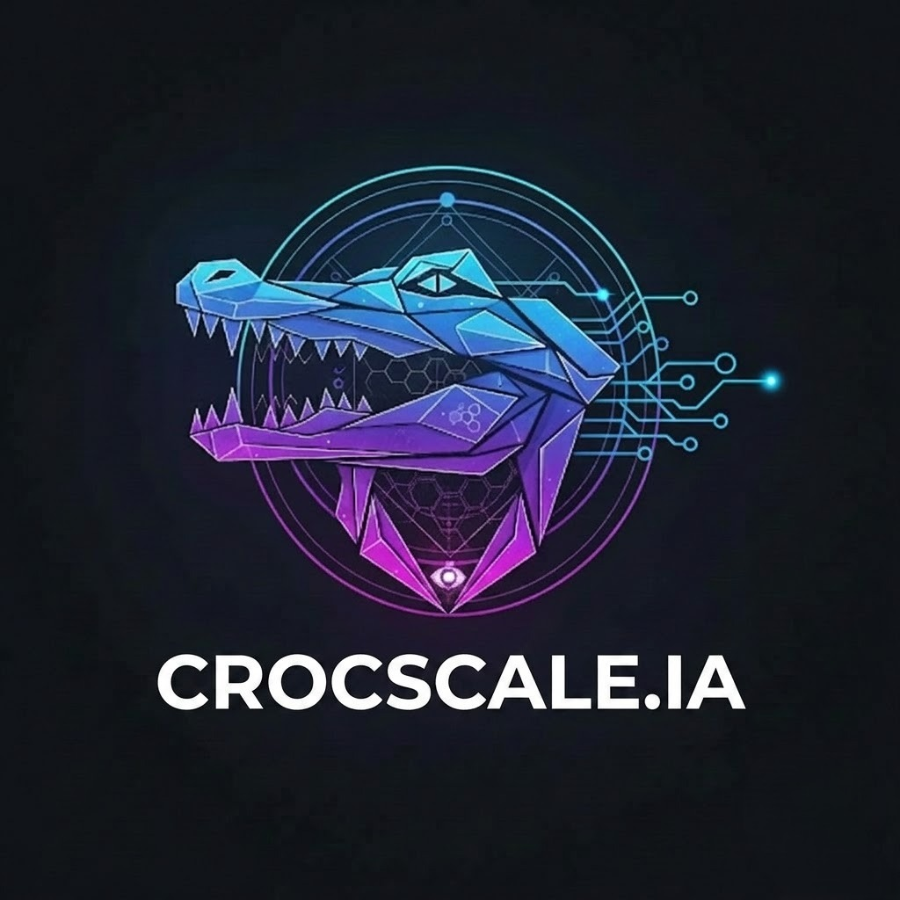
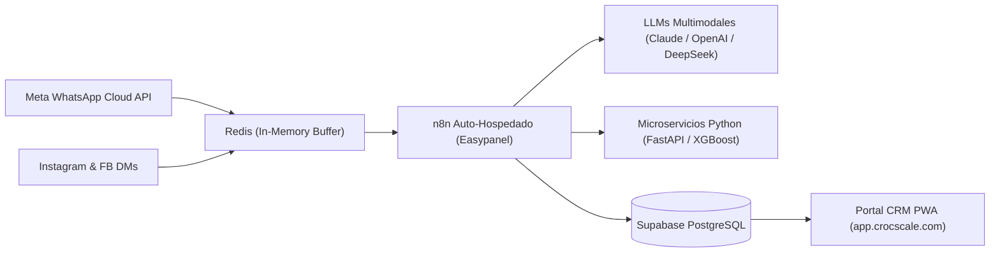

# 🐊 CrocScale IA — Exposición del Trabajo Práctico Integrador (TPI)

<p align="center">
  
</p>

<p align="center">
  <strong>Tecnicatura Superior en Ciencia de Datos e Inteligencia Artificial</strong><br>
  <strong>Instituto de Formación Técnica Superior Nº 24 (IFTS 24) — CABA</strong><br>
  <em>Asignatura: Aproximación al Campo Laboral (Práctica Profesionalizante 1) • 2026 – 2º Cuatrimestre</em>
</p>

<p align="center">
  <strong>Estudiante:</strong> Nicolás Marcelo Galarza Vázquez (AI Automation Architect & Founder)<br>
  <strong>Docente a Cargo:</strong> Prof. Geronimo Gabriela Natalia<br>
  <strong>Sitio Web Oficial:</strong> <a href="https://crocscale.com">www.crocscale.com</a> • <strong>Portal CRM:</strong> <a href="https://app.crocscale.com">app.crocscale.com</a>
</p>

---

## 🌟 Título del Proyecto
> ### **"AI-Sales Engine: Lead Scoring, Predicción de Churn y Validación Multimodal de Pagos"**
> *Arquitectura de datos y agentes inteligentes multimodales para la transformación de datos conversacionales no estructurados en decisiones comerciales predictivas.*

---

## 🚀 Acceso Rápido a los Recursos

| Recurso | Archivo / Enlace | Descripción |
| :--- | :--- | :--- |
| 🌐 **Presentación Web Interactiva** | [`index.html`](index.html) | Diapositivas web responsive con cronómetro (08:00), navegación por teclado y cajón de notas de orador (tecla `G`). |
| 📄 **Presentación PowerPoint 16:9** | [`presentacion_crocscale_ia.pptx`](presentacion_crocscale_ia.pptx) | Archivo PPTX editable en Canva, Google Slides o PowerPoint con tipografía Segoe UI agrandada y paleta dark tech. |
| 🎙️ **Machete de Oratoria (8 Minutos)** | [`machete_exposicion.md`](machete_exposicion.md) | Resumen ejecutivo minuto a minuto, disparadores, frases conectoras y respuestas a preguntas de la docente. |
| 🐊 **Logo Oficial de Alta Resolución** | [`logo.jpg`](logo.jpg) | Isotipo oficial de CrocScale IA en 1024x1024. |

---

## ⏱️ Estructura de la Exposición Oral (8 Minutos Máximo)

```
[0:00 - 1:00]  Slide 1: Carátula e Introducción Institucional (IFTS 24, TPI, CrocScale IA)
[1:00 - 2:00]  Slide 2: Organización Seleccionada (SaaS & AI Agency B2B, Clientes de Once, Stack)
[2:00 - 3:00]  Slide 3: Diagnóstico Operativo (70% ventas perdidas, ceguera de datos, comprobantes manuales)
[3:00 - 4:15]  Slide 4: Proyecto Innovador: AI-Sales Engine (OCR 10% seña, ML Lead Scoring, Churn)
[4:15 - 5:15]  Slide 5: Beneficios e Impacto Cuantificado (-90% validación, +25% conversión, 10x escala)
[5:15 - 6:15]  Slide 6: Rol del Estudiante (AI Automation Architect & Lead Data Engineer)
[6:15 - 7:15]  Slide 7: Competencias Profesionales (Técnica, Analítica y Liderazgo/Frame Control)
[7:15 - 8:00]  Slide 8: Conclusiones, Próximos Pasos (Voice Bots, MercadoLibre) y Espacio de Preguntas
```

---

## 📊 Métricas Clave de Impacto Demostradas en Producción

```
   ┌───────────────┐     ┌───────────────┐     ┌───────────────┐
   │     -90%      │     │     +25%      │     │      10x      │
   │  VALIDACIÓN   │     │  CONVERSIÓN   │     │ ESCALABILIDAD │
   └───────┬───────┘     └───────┬───────┘     └───────┬───────┘
           │                     │                     │
   De 4 horas manuales    Priorización comercial   +20.000 chats/mes
   a <10s vía OCR         de prospectos calientes  sin costos fijos extra
```

* **-90% en tiempo de validación de pagos:** Verificación automática de transferencias bancarias mediante visión computacional y control estricto del 10% de seña obligatoria.
* **+25% en la tasa de conversión comercial:** Vendedores humanos atienden de forma prioritaria a los prospectos con Lead Score > 80.
* **10x en escalabilidad operativa:** Capacidad concurrente 24/7 con latencia garantizada de 30 segundos a 1 minuto por conversación.

---

## 🛠️ Stack Tecnológico en Producción



* **Infraestructura Cloud:** Easypanel sobre VPS de Hostinger (contenedores Docker soberanos).
* **Gestión de Memoria & Concurrencia:** Redis Cloud para buffers de turnos conversacionales y prevención de colisiones.
* **Persistencia Relacional:** Supabase (PostgreSQL) con tablas `n8n_chat_histories`, órdenes y clientes.
* **Machine Learning & NLP:** Scikit-Learn, XGBoost y microservicios FastAPI.
* **Modelos Multimodales:** Anthropic Claude, OpenAI y DeepSeek vía LiteLLM (ahorro del 98% en tokens vía `systemMessage`).

---

## 👥 Clientes y Cartera Activa de CrocScale IA
1. **ADAR Insumos:** Mayorista de bazar y ferretería (memoria optimizada a 8 turnos en WhatsApp).
2. **Bross Underwear / NNN Store:** Marca de indumentaria masculina (detección automática de clientes en base de datos).
3. **Nacha Home:** Blanquería y decoración del hogar (asesoramiento y presupuestos automáticos).
4. **Sakkal Mayorista:** Indumentaria y blanquería en zona comercial Once.

---

## 👤 Autor
**Nicolás Marcelo Galarza Vázquez**  
*AI Automation Architect & Lead Data Engineer*  
- **Email:** nicolas.galarza@crocscale.com | nikovaz1515@gmail.com  
- **LinkedIn:** [Nicolás Galarza](https://linkedin.com)  
- **GitHub:** [@Nikovaz](https://github.com/Nikovaz)  
- **Web:** [https://crocscale.com](https://crocscale.com)  
